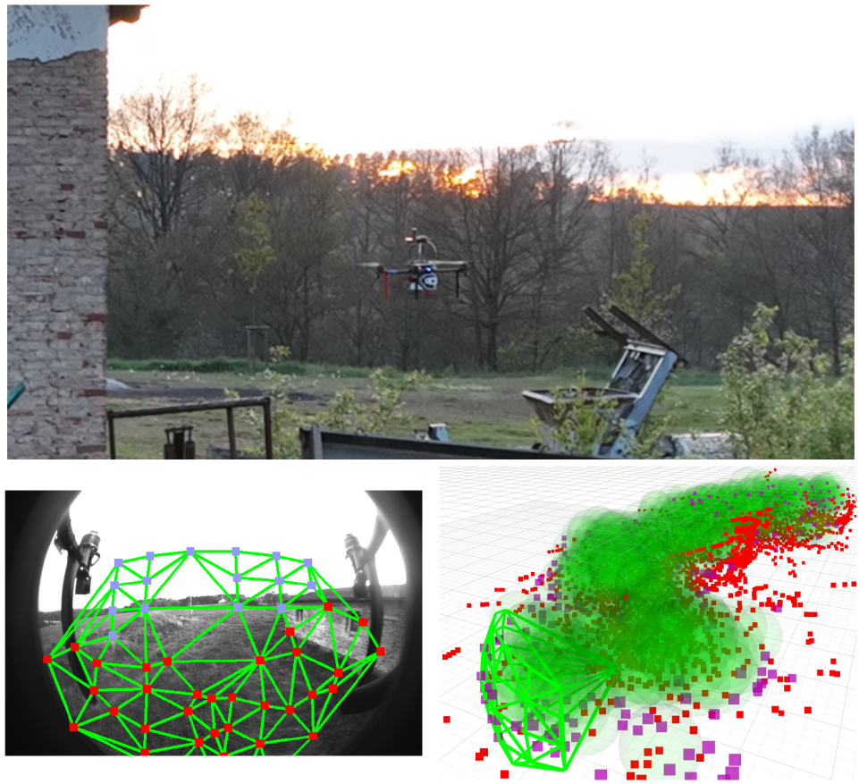

# MonoSpheres
 
 
This is the code repository for the MonoSpheres mapping and exploration approach for monocular UAVs which has achieved outdoor monocular exploration in multiple real-world and simulated environments.

Videos - [https://youtu.be/hxYtRvwQrKc](https://youtu.be/hxYtRvwQrKc)

The accompanying paper "[MonoSpheres: Large-Scale Monocular SLAM-Based UAV Exploration Through Perception-Coupled Mapping and Planning](https://ieeexplore.ieee.org/document/11517436)" has been accepted to Robotics and Automation Letters and is available as open access. Please cite this publication if you use our work in your research.

This version runs on **ROS 2 Jazzy** with the **MRS UAV System** and the **FlightForge** simulator.
The original ROS 1 (Noetic + Gazebo) version used for the paper is preserved under the git tag
[`ros1`](../../tree/ros1).

## Installation

Tested on Ubuntu 24.04.

1. **ROS 2 Jazzy and the MRS UAV System.** Follow https://ctu-mrs.github.io/docs/installation/,
   then install the system with the FlightForge bridge, OpenVINS and the zenoh middleware:
   ```bash
   sudo apt install ros-jazzy-mrs-uav-system-full ros-jazzy-mrs-uav-flightforge-simulator \
                    ros-jazzy-mrs-open-vins-core ros-jazzy-rmw-zenoh-cpp
   ```
2. **FlightForge.** Download the FlightForge Linux binary (tested with v0.11.2) and unpack it.
   The session expects it in `~/Downloads/FlightForge_Linux_v_0_11_2`; for any other location,
   export `FLIGHTFORGE_PATH=/path/to/the/directory/with/mrs_flight_forge.sh` (e.g. in `~/.bashrc`).
3. **Workspace.** Clone this repository anywhere and symlink it into a colcon workspace:
   ```bash
   git clone https://github.com/ctu-mrs/monospheres.git ~/git/monospheres
   mkdir -p ~/monospheres_ws/src && cd ~/monospheres_ws
   ln -s ~/git/monospheres/monospheres src/monospheres
   colcon init
   colcon build --symlink-install
   echo "source ~/monospheres_ws/install/setup.bash" >> ~/.bashrc
   source ~/.bashrc
   ```
   `colcon init` is needed because the MRS system installs a `colcon` wrapper that only builds in
   initialized workspaces.
4. **Python environment.** The pip-only dependencies (open3d, trimesh, embreex, numba, ...) live in a
   venv inside the package, created with access to the system ROS 2 Python packages:
   ```bash
   python3 -m pip install --upgrade pip
   ~/git/monospheres/monospheres/create_python_env.sh
   ```
   The tmux session activates this venv automatically.

## Running the FlightForge example

```bash
~/git/monospheres/monospheres/tmux_scripts/flightforge_monospheres/start.sh
```

This starts a tmux session (MRS tmux config and keybindings, see
https://github.com/ctu-mrs/mrs_cheatsheet) that launches FlightForge, the MRS UAV core, OpenVINS,
MonoSpheres and RViz. After the automatic takeoff (3 m), the session waits for OpenVINS to
initialize, flies 4 m forward, switches the UAV's state estimate to the OpenVINS odometry and starts
the exploration. Close the session with `Ctrl+a, k, Enter` (or run `kill.sh`).
`detached_start.sh` starts the same session in the background without attaching to it.

Session configuration lives in `monospheres/tmux_scripts/flightforge_monospheres/`:
- `config/simulator.yaml` — FlightForge world and UAV spawn position/heading
- `config/custom_config.yaml` — MRS overrides (takeoff height)
- `config/open_vins/` — OpenVINS estimator and camera/IMU calibration for the FlightForge camera

MonoSpheres parameters are in `monospheres/config/flightforge.yaml` (shared with the mapping and
planning modules, with comments explaining their purpose). The launch file is
`ros2 launch monospheres monospheres.launch.py` (args `config`, `custom_config`, `use_sim_time`).

## Troubleshooting
- **The UAV took off but nothing happens.** First check that OpenVINS initialized: the `vio` tab
  should stop printing initialization messages and `ros2 topic echo /uav1/open_vins/odomimu` should
  publish. The post-takeoff steps wait for this and print `!!! VIO NOT INITIALIZED !!!` on timeout.
  OpenVINS initializes from a static start and needs visible texture/structure in front of the
  camera; a spawn facing a flat empty plane often fails. Change the spawn in `config/simulator.yaml`.
- **Then check the `monospheres` tab.** The node prints runtime statistics for map building and
  planning. If the map is built but the UAV does not explore, rerun the service in the
  `exploration_start` tab.
- **Everything is slow / long pauses before moving.** Check the `simulator` tab for the actual real-time
  factor (`actual RTF`). FlightForge renders on the GPU; at a low RTF all sim-time timeouts in the
  planner take proportionally longer in wall time.
- **Two simulations / clocks interfere.** Other ROS 2 processes on the same `ROS_DOMAIN_ID` (e.g. set in
  `~/.bashrc`) also publish `/clock` and `/tf`. Stop them or use a different domain ID.

## License
The MonoSpheres code is released under the [MIT License](LICENSE).
